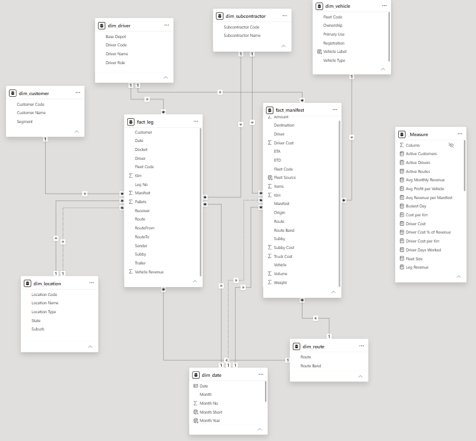

# HB Fresh Logistics: Performance Analytics (Power BI)

An end-to-end Power BI project analysing 12 months of operations for a fictional refrigerated freight company: **5,000 trips, 11,479 deliveries, 40 customers, 45 drivers, 33 owned and rental vehicles and 6 subcontractors** across Melbourne, Adelaide and Sydney.

The report answers one question: **where does the business make and lose money, and what should it look at changing?**

> All data is synthetic. Company, customer, driver and vehicle names are fictional. The dataset was modelled on how a real fresh-produce logistics operation records its trips and costs.


---

## Business questions

1. Which routes, route types and customers drive profit?
2. Which vehicles earn their keep, and which lose money?
3. How is work and revenue spread across drivers and depots?
4. When should work go to our own fleet, and when to subcontractors?
5. What seasonal and weekday patterns affect capacity planning?

## Headline findings (full period, Nov 2025 – Oct 2026)

| | |
|---|---|
| **Revenue** | $5.36M |
| **Profit*** | $1.51M (28.1% margin) |
| **Trips (manifests)** | 5,000 |
| **Subcontractor share of revenue** | 30.9% |

- **Linehaul makes 95% of profit.** Four interstate routes (Melbourne ↔ Adelaide, Melbourne ↔ Sydney) earn $1.43M at a 34–35% margin.
- **Metro runs at a loss (−1.4%).** 9 of the 10 Metro routes lose money, even though Metro has the highest revenue per km ($6.80).
- **The own fleet loses money on Metro (−5.6%), while subcontractors make about +20% on the same type of work.** On linehaul it's the reverse: own fleet 41% vs subcontractors 22%.
- **All refrigerated vans (−18%) and rental trucks (−46%) are loss-making.** Prime movers earn about 97% of own-fleet profit.
- **Customer concentration risk:** the largest customer is 20% of revenue, and the top 10 are 70%.
- **Seasonality:** December is the peak ($639K revenue) and January the low ($348K). Friday is the busiest day and Sunday the quietest.

\*Profit = Revenue − Driver, Subcontractor and Truck costs. Overheads are not included.

Full write-up: [`Review_Report.pdf`](Review_Report.pdf) · Data dictionary: [`data_dictionary.md`](data_dictionary.md)

---

## Report pages

| Page | Purpose |
|---|---|
| **Home** | Dashboard: KPI strip and one headline chart per area |
| **Trends & Seasonality** | Monthly revenue and margin, manifests by route band and weekday |
| **Route & Customer Profitability** | Profit by route, route matrix with conditional formatting, top customers, revenue by segment |
| **Fleet Performance** | Profit and margin by vehicle type and vehicle, km vs profit scatter |
| **Driver Performance** | Workload and revenue by driver, role and depot |
| **Own Fleet vs Subcontractors** | Margin comparison by route band, subcontractor mix, subby share over time |
| *Route Detail* (drill-through) | Right-click any route to see its trend, customers, drivers and own vs subby split |
| *TT Trend* (tooltip page) | Hover over a route, vehicle or band to see a mini profit trend |

| | |
|---|---|
|  |  |
|  |  |
|  |  |

---

## Data model

A star schema with two fact tables at different grains:

- **fact_manifest**: one row per trip (revenue and costs)
- **fact_leg**: one row per delivery or drop (customer, pallets, leg revenue)
- **Dimensions:** dim_date, dim_route, dim_vehicle, dim_driver, dim_customer, dim_location, dim_subcontractor



Modelling decisions:
- **dim_route** is shared by both fact tables, so Route and Route Band filters apply to trip *and* customer figures.
- **Role-playing relationships:** ETD is the active date relationship (ETA is inactive), and pickup location is active (delivery location is inactive, used through `USERELATIONSHIP`).
- **dim_vehicle** joins on registration, because the "RENTAL" fleet code is shared by several trucks.
- Customer analysis uses **leg revenue**. Costs are recorded per trip, so they aren't allocated to individual customers.
- All relationships are single-direction, and fact-table keys are hidden.

## Techniques used

- **Power Query:** CSV ingestion, type setting, column split and merge, a parameterised data source (`DataFolder`)
- **DAX:** 40+ measures, including time intelligence (`DATEADD` month-on-month), `USERELATIONSHIP`, `TOPN` for dynamic text, `SUMMARIZE` for driver-days and context-aware share %
- **Visual design:** custom JSON theme, conditional formatting (rules-based colours, data bars, red-below-zero), combo charts with aligned axes
- **Interactivity:** page navigator, report-page tooltip, drill-through page, synced slicers, clear-slicers buttons
- **Storytelling:** Narrative visuals plus written recommendations on each page

## How to open

1. Install [Power BI Desktop](https://powerbi.microsoft.com/desktop/) (free).
2. Clone or download this repo.
3. Open `PowerBI.pbip`.
4. **Transform data → Edit parameters**, set `DataFolder` to the `data` folder in your copy (end the path with `\`), then **Refresh**.


## Repository structure

```
├── PowerBI.pbip              Open this in Power BI Desktop
├── PowerBI.Report/           Report definition (pages, visuals)
├── PowerBI.SemanticModel/    Model definition (tables, relationships, DAX in TMDL)
├── data/                     7 synthetic CSV files
├── theme/                    Custom report theme (JSON)
├── Review_Report.pdf         Findings and recommendations write-up
├── data_dictionary.md        Tables, columns and measures explained
└── images/                   Screenshots
```

## Author

**Ehsan K.** · Graduate Certificate in Professional Data Analytics (Swinburne University)
Built using hands-on experience as a driver and operations coordinator in refrigerated logistics.
